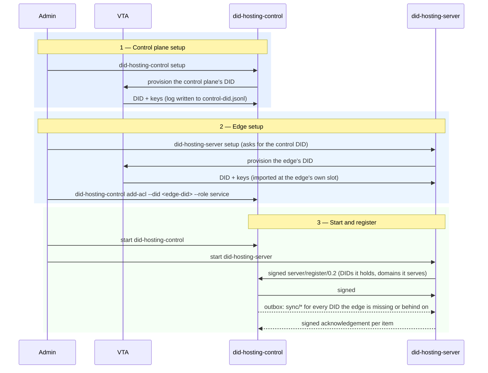

# Bootstrap & Startup Guide

> **Status:** current

How to stand up a DID Hosting deployment from nothing: a single
`did-hosting-daemon`, or a distributed control plane with one or more edges
(and, optionally, a witness and a watcher).

Every command below is in the generated [CLI reference](cli-reference.md);
every config key and environment variable is in the
[configuration reference](configuration.md). The words *edge*, *control plane*,
*slot* and *owner* are defined in the [glossary](glossary.md).

## Pick a topology

| You want | Run | Notes |
|---|---|---|
| One host serving DIDs, with the management UI | `did-hosting-daemon` | Recommended. Control plane, edge, witness (and optionally watcher) in one process, sharing one store. |
| Several hosts serving the same DIDs, managed centrally | `did-hosting-control` + N × `did-hosting-server` | The control plane is the only source of record; edges are caches it fills. |
| Witness proofs for `did:webvh` logs | `webvh-witness` (or `[enable] witness = true` in the daemon) | Optional. |
| A read-only mirror of DIDs from other hosts | `webvh-watcher` (or `[enable] watcher = true`) | Optional. |

Default ports: daemon `8534`, control `8532`, server `8530`, witness `8531`,
watcher `8533`.

## Prerequisites

- The binaries, built from this workspace (see the [root README](../README.md))
  or installed from crates.io.
- For a **VTA-managed** identity (every standalone binary, and the daemon in
  its default mode): access to a VTA, and an admin there who can create a
  context for each service (`pnm contexts create`, printed for you by the
  wizard).
- For a **self-managed** daemon: nothing else — see
  [Self-managed mode](#self-managed-mode-no-vta--daemon-only).
- A public origin for each node's own `did:webvh`
  (e.g. `https://did.example.com`). For anything but local testing, a TLS
  terminator in front of it — see [deployment](deployment.md).
- Optionally a DIDComm/TSP **mediator** DID. A node with a mediator advertises
  `TSPTransport` / `DIDCommMessaging` in its DID document and talks to its peers
  over it. A node without one is HTTP-only.

## Daemon (all-in-one)

The quickest working install needs no VTA at all:

```bash
did-hosting-daemon setup --from examples/did-hosting-daemon-self-managed.toml
did-hosting-daemon invite --did <your-admin-did> --role admin
did-hosting-daemon
```

`invite` prints an enrolment URL and, separately, a claim code: open the URL,
type the code, and bind a passkey. From then on, sign in to the console at the
daemon's `public_url`.

For a VTA-managed daemon run the interactive wizard (`did-hosting-daemon
setup`) or drive it from `examples/did-hosting-daemon-build.toml` — see
[Non-interactive setup](#non-interactive-setup-recipe-driven).

A daemon config looks like:

```toml
server_did = "did:webvh:<scid>:did.example.com"
public_url = "https://did.example.com"
did_hosting_url = "https://did.example.com"
# mediator_did = "did:webvh:..."   # optional: TSP / DIDComm reachability

[server]
host = "0.0.0.0"
port = 8534

[enable]
server = true    # public DID resolution
control = true   # the control plane: Trust Tasks, UI, sign-in
witness = true
watcher = false
```

In daemon mode the services coordinate in-process: there is no registration,
no stats sync and no outbound push between them. The DIDs the control plane
stores are the DIDs the embedded server resolves.

## Distributed: control plane + edges

### How the pieces trust each other

There are no shared secrets and no sessions between nodes. Each node has its
own `did:webvh`, and every message between nodes is a **signed Trust Task**:

- The **control plane** authorises an edge by its DID: the edge's DID must be in
  the control plane's ACL with the `service` role.
- An **edge** takes directives from exactly one party, its configured
  `control_did`. It checks every inbound document's proof against that DID and
  answers nothing else. It keeps no ACL and no sessions of its own.
- How a message travels — TSP, DIDComm or HTTPS — is read from the recipient's
  DID document (`TSPTransport`, then `DIDCommMessaging`, then
  `TrustTaskHTTPS`), falling back to the sender's own configured mediator. See
  [TSP transport](tsp-transport.md).



### 1. Control plane

```bash
did-hosting-control setup
```

The wizard asks how to reach the VTA (online, or the two offline phases), the
**DID hosting URL** and **path** for the control plane's own DID (the log is
written to `control-did.jsonl`), the messaging transport, the **public URL** the
browser console and WebAuthn use, host/port (default `8532`), log settings,
data directory, the secrets backend, and an optional first **admin** ACL entry
(an existing DID or a freshly generated `did:key`).

Note the control plane's DID (`server_did` in the written `config.toml`): every
edge needs it.

### 2. Each edge

```bash
did-hosting-server setup
```

The wizard asks how to reach the VTA, the edge's **public URL** (this becomes
its `did:webvh`, so each edge gets its own), the mediator and transports, the
**control plane's DID** (required — the edge does not start without
`control_did`), host/port (default `8530`), log settings, data directory and
the secrets backend. It imports the edge's own DID at its slot and prints the
command that admits it to the control plane:

```bash
did-hosting-control add-acl --did <edge-did> --role service
```

`add-acl` writes to the control plane's store directly, so run it with the
control plane stopped (or grant the entry live from the console's **Access** page, or
with an `acl/grant/0.2` Trust Task).

### 3. Host the control plane's own DID

Edges verify every document the control plane sends by resolving
`control_did`, so that DID must resolve. Publish it **through the control
plane** so that it is part of the authoritative store and is replicated to
every edge: a `did/register/0.1` Trust Task for the control DID's slot (the VTA
does this when this control plane is its webvh hosting server; otherwise an
admin can send it — see [sending Trust Tasks](sending-trust-tasks.md)).

`did-hosting-server bootstrap-did --path <path> --did-log control-did.jsonl`
loads the log on one edge directly, which is enough to break the
chicken-and-egg on first start. It is not a substitute: an edge is a cache, and
when it registers, the control plane queues a `sync/delete` for every slot the
edge reports that the control plane does not itself publish. Only the edge's
own DID is exempt.

### 4. Start

```bash
did-hosting-control --config control/config.toml
did-hosting-server  --config edge/config.toml
```

On startup an edge with a mediator:

1. serves HTTP first (its own DID must be resolvable before it can
   authenticate to the mediator), then resolves its own DID and establishes its
   identity;
2. connects to the mediator and, for TSP, establishes a relationship with the
   control plane (on every connect, not just the first);
3. sends a signed `server/register/0.2` to `control_did`, listing the DIDs it
   holds (except its own) and the domains it serves. It re-registers on every
   mediator reconnect and every 10 minutes; each registration is a delta
   resync request;
4. reconciles against the control plane every `replication.reconcile_interval_secs`
   (60 s). If it goes longer than `replication.staleness_bound_secs` (300 s)
   without a clean reconcile, `/api/health` answers `503` so a load balancer
   drains it.

The control plane checks the registration's proof and that its signer has the
`service` role, records the edge in the registry, and queues — in its
**transactional outbox** — a `sync/*` row for each DID the edge is missing or
behind on, and a delete for each slot it should no longer serve. Every later
change (publish, delete, rollback, suspension, agent-name change, domain
assign/unassign/purge) is queued in the same store transaction as the change
itself. The outbox worker sends each row as a freshly signed document and
removes it only when the edge returns a signed acknowledgement; unacknowledged
rows are resent with backoff and are re-derived on the edge's next
registration if they are ever dropped.

An edge **without** a mediator has no messaging service: it cannot register or
reconcile, logs `no messaging service: this edge cannot reconcile with its
control plane`, and reports degraded once the staleness bound passes. Add it to
the registry with the `registry/admin-register/0.2` Trust Task (the console's
**Servers** page) and give its DID document a `TrustTaskHTTPS` service so the
control plane can push to it.

### Witness and watcher (optional)

```bash
webvh-witness setup     # default port 8531
webvh-watcher setup     # default port 8533
```

Each mints its own DID the same way. Host each DID through the control plane
(as in step 3). A watcher the control plane should push to is listed in the
control plane's `[[registry.watchers]]` (`url` + `did`).

## Verifying the setup

```bash
# Liveness + own DID served (+ replication fresh, on an edge). 200 or 503.
curl -i http://localhost:8530/api/health

# Resolution. The root DID's log is served at /.well-known/did.jsonl.
curl http://localhost:8530/.well-known/did.jsonl
curl http://localhost:8530/<path>/did.jsonl

# Offline diagnostics for each config (exits non-zero on a failed check).
did-hosting-server  --config edge/config.toml    health
did-hosting-control --config control/config.toml health

# The ACL (offline, reads the store directly).
did-hosting-control --config control/config.toml list-acl
```

The fleet as the control plane sees it — registered edges, status, last
inbound/outbound transport, served domains — is the console's **Servers** page,
or the `registry/list/0.2` Trust Task:

```bash
did-hosting-control send-trust-task --key admin-key.json --type registry/list/0.2
```

There is no REST registry endpoint; see
[sending Trust Tasks](sending-trust-tasks.md) and the
[Trust Task catalogue](trust-tasks.md).

## Self-managed mode (no VTA — daemon only)

For deployments with no parent VTA — internal-only installs, dev/test, or
operators who want to be their own trust root — the daemon can generate its own
keys and DID.

| | VTA mode (default) | Self-managed mode |
|---|---|---|
| Daemon's signing + key-agreement keys | Provisioned by the VTA at setup | Generated locally at setup |
| Daemon's own DID | Minted by the VTA | A locally built `did:webvh`, hosted by the daemon itself |
| `vta_credential` in secrets | Set | Never set |
| `[vta]` config table | `url`, `did`, `context_id` | Empty / omitted |
| Tenant DID publication | Tenants' VTAs publish over TSP / DIDComm / HTTPS | **Identical** — self-managed changes only how the daemon gets *its own* identity |

**Daemon only.** The standalone binaries refuse the self-managed choice.
**Permanent.** A self-managed daemon cannot later be moved onto a VTA; start a
fresh deployment instead.

```bash
did-hosting-daemon setup
#  > Self-managed (no VTA — daemon manages its own DID)
```

The wizard skips every VTA prompt, generates the keys, builds and imports the
daemon's `did:webvh`, and writes `[identity] mode = "self-managed"`. It warns
(but accepts) an `http://` or loopback public URL, for local use.

It does not seed an admin. Enrol the first one with a passkey invite:

```bash
did-hosting-daemon invite --did <ADMIN_DID> --role admin --config config.toml
```

The URL and the claim code are two halves of one invite: deliver them over
different channels when the admin is someone else. Neither is stored (only
their hashes), and five wrong claim codes cancel the invite. Once an admin is
signed in, further invites come from the console
(`auth/passkey/enroll/invite/0.3`); run `invite` again if one is lost.

A config without an `[identity]` block loads as `mode = "vta"`. The mode can
also be set with `DID_HOSTING_IDENTITY_MODE` (`vta` or `self-managed`).

## Non-interactive setup (recipe-driven)

Every `setup` subcommand accepts a **recipe** TOML holding the answers the
wizard would prompt for. A recipe contains no secrets: keys are generated by
setup, cloud credentials come from the environment.

```bash
# Online VTA mode: phase 1 mints an ephemeral did:key for the VTA admin to enrol.
did-hosting-server setup --setup-key-out setup.key --context did-hosting
# (the VTA admin enrols the printed did:key)
did-hosting-server setup --from examples/did-hosting-server-build.toml \
                         --setup-key-file setup.key
```

```bash
# Self-managed daemon: one step.
did-hosting-daemon setup --from examples/did-hosting-daemon-self-managed.toml
```

Fully **air-gapped** installs run both phases of the sealed-bundle flow from
the same recipe:

```bash
# Phase 1: [deployment].vta_mode = "offline-prepare", [vta].request_path = "bootstrap-request.json".
# Writes the request and keeps the ephemeral seed in the configured secret backend.
did-hosting-server setup --from recipe.toml

# The VTA admin returns bundle.armor and its SHA-256 digest out of band.

# Phase 2: vta_mode = "offline-complete", [vta].bundle_path, [vta].expect_digest.
did-hosting-server setup --from recipe.toml
```

Both phases must use the same `[secrets]` backend, or phase 2 cannot find the
seed.

| Recipe (`examples/`) | Drives |
|---|---|
| `did-hosting-daemon-self-managed.toml` | `did-hosting-daemon setup --from`, no VTA |
| `did-hosting-daemon-build.toml` | `did-hosting-daemon setup --from`, VTA-managed |
| `did-hosting-server-build.toml` | `did-hosting-server setup --from` (set `[identity].control_did`) |
| `did-hosting-control-build.toml` | `did-hosting-control setup --from` |
| `webvh-witness-build.toml` | `webvh-witness setup --from` |
| `webvh-watcher-build.toml` | `webvh-watcher setup --from` |

| `setup` flag | Effect |
|---|---|
| `--from <path>` | Drive setup from a recipe; skip every prompt. |
| `--force-reprovision` | Allow overwriting an existing install (backs up `config.toml` to `config.toml.bak` first). |
| `--non-interactive` | Requires `--from`; fail rather than fall back to a prompt. |

**Reprovision safety.** Before rotating any credential, setup probes the
configured secret backend. If an install is already provisioned it refuses
(exit code 4) unless `--force-reprovision` or `[reprovision].force = true` is
set.

**Uninstall.** `did-hosting-{daemon,server,control} uninstall` and
`webvh-witness uninstall` list the managed secret entries and companion files,
ask for a typed `DELETE`, and remove them (`--yes` skips the prompt). The store
and data directory are not removed.

| Exit code | Meaning |
|---|---|
| 0 | Success |
| 1 | Anything else |
| 2 | VTA: no transport worked (every advertised pre-auth path failed) |
| 3 | VTA: post-auth request body rejected |
| 4 | Reprovision refused (an install exists; pass `--force-reprovision`) |
| 5 | Recipe parse / validation failed |

Recipe fields can be overridden at load time by the runtime environment
variables below, so one recipe can be templated across environments.

## Cold-start bootstrap (no running services)

Bootstraps a VTA, a mediator and a DID host from nothing, when none of them can
yet resolve the others. Use the **daemon** as the DID host: a standalone edge
needs a control plane, and anything loaded on an edge directly is removed when
it first registers.

1. **VTA (offline):** `vta setup`, creating the VTA DID in serverless mode. Keep
   `did-vta.jsonl` and the VTA credential.
2. **DIDs (offline):** `vta create-did-webvh --context <ctx> --label daemon` and
   `--context mediator --label mediator`, exporting each secrets bundle.
3. **Daemon (offline):**

   ```bash
   did-hosting-daemon import-secrets --config config.toml --vta-bundle <daemon-bundle>
   did-hosting-daemon load-did --config config.toml --path .well-known   --did-log did-daemon.jsonl
   did-hosting-daemon load-did --config config.toml --path <vta-path>      --did-log did-vta.jsonl
   did-hosting-daemon load-did --config config.toml --path <mediator-path> --did-log did-mediator.jsonl
   ```

4. **Start the daemon.** All three DIDs now resolve over HTTP.
5. **Mediator:** `mediator-setup-vta --import-bundle`, giving it the mediator
   bundle, the VTA credential and `did-mediator.jsonl` (so it resolves its own
   DID locally); then start it.
6. **Start the VTA.** Everything can now resolve everything else.

Afterwards, register the daemon with the VTA as a webvh server
(`vta webvh add-server --id <id> --did <daemon-did>`) and change the mediator's
`jwt_authorization_secret` for production.

## Environment variables

Every binary reads its config file, then applies environment overrides under
its own prefix. The full list, with every config key, is in the
[configuration reference](configuration.md); the overview:

| Binary | Prefix | Config path variable |
|---|---|---|
| `did-hosting-server` | `DID_HOSTING_` (the deprecated `WEBVH_` is still read; `DID_HOSTING_` wins) | `DID_HOSTING_CONFIG_PATH` |
| `did-hosting-control` | `CONTROL_` | `CONTROL_CONFIG_PATH` |
| `did-hosting-daemon` | `DAEMON_` (and `DAEMON_WITNESS_STORE_*` for `[witness_store]`) | `DAEMON_CONFIG_PATH` |
| `webvh-witness` | `WITNESS_` | `WITNESS_CONFIG_PATH` |
| `webvh-watcher` | `WATCHER_` | `WATCHER_CONFIG_PATH` |

### Identity and peers

| Variable | Binaries | Config key |
|---|---|---|
| `<PREFIX>_SERVER_DID` | all | `server_did` (this node's own DID) |
| `<PREFIX>_MEDIATOR_DID` | all | `mediator_did` |
| `DID_HOSTING_PUBLIC_URL`, `CONTROL_PUBLIC_URL`, `DAEMON_PUBLIC_URL` | server, control, daemon | `public_url` |
| `CONTROL_DID_HOSTING_URL`, `DAEMON_DID_HOSTING_URL` | control, daemon | `did_hosting_url` |
| `DID_HOSTING_CONTROL_DID` | server | `control_did` |
| `<PREFIX>_VTA_URL`, `_VTA_DID`, `_VTA_CONTEXT_ID` | server, control, witness | `[vta]` |
| `CONTROL_REGISTRY_HEALTH_CHECK_INTERVAL` | control | `registry.health_check_interval` |
| `WATCHER_SOURCE_DIDS` | watcher | `sync.source_dids` (comma-separated) |
| `DID_HOSTING_IDENTITY_MODE` | daemon | `identity.mode` |

### Shared by every prefix

| Variable | Config key |
|---|---|
| `<PREFIX>_SERVER_HOST`, `_SERVER_PORT` | `server.host`, `server.port` |
| `<PREFIX>_SERVER_TRUSTED_PROXIES` | `server.trusted_proxies` |
| `<PREFIX>_LOG_LEVEL`, `_LOG_FORMAT` | `log.level`, `log.format` |
| `<PREFIX>_FEATURES_DIDCOMM`, `_TSP`, `_AGENT_NAMES`, `_HTTP_LISTENER` (`_REST_API` is the old name) | `[features]` |
| `<PREFIX>_REPLAY_*` | `[replay]` |
| `<PREFIX>_AUTH_*` (control and daemon; the edge, witness and watcher hold no sessions) | `[auth]` |

Boolean variables accept `1`/`true`/`yes`/`on` and `0`/`false`/`no`/`off`, in
any case; anything else stops the service with a message naming the variable.

### Cloud secret backends

| Variable | Description |
|---|---|
| `<PREFIX>_SECRETS_KEYRING_SERVICE` | OS keyring service name |
| `<PREFIX>_SECRETS_AWS_SECRET_NAME`, `_AWS_REGION` | AWS Secrets Manager |
| `<PREFIX>_SECRETS_GCP_PROJECT`, `_GCP_SECRET_NAME` | GCP Secret Manager |
| `<PREFIX>_SECRETS_AZURE_VAULT_URL`, `_AZURE_SECRET_NAME` | Azure Key Vault |
| `<PREFIX>_SECRETS_VAULT_ADDR`, `_VAULT_KV_MOUNT`, `_VAULT_SECRET_PATH`, `_VAULT_SECRET_KEY`, `_VAULT_NAMESPACE`, `_VAULT_AUTH_METHOD`, `_VAULT_TOKEN`, `_VAULT_APPROLE_ROLE_ID`, `_VAULT_APPROLE_SECRET_ID`, `_VAULT_APPROLE_MOUNT`, `_VAULT_SKIP_VERIFY` | HashiCorp Vault |
| `<PREFIX>_SECRETS_K8S_SECRET_NAME`, `_K8S_NAMESPACE`, `_K8S_SECRET_KEY` | Kubernetes Secret |

`secrets.backend`, when set, selects the backend outright. Otherwise the
precedence is AWS → GCP → Azure → Vault → Kubernetes → keyring. Plaintext is
never chosen implicitly: it needs `backend = "plaintext"` and
`confirm_plaintext = true`, and is for tests only. A backend selected on a
binary built without its feature, or a keyring that cannot be opened, is a
startup error. Compile in only the backends you use (`aws-secrets`,
`gcp-secrets`, `azure-secrets`, `vault-secrets`, `k8s-secrets`, `keyring`).

### Storage backends

| Variable | Description |
|---|---|
| `<PREFIX>_STORE_DATA_DIR` | fjall on-disk path (default backend) |
| `<PREFIX>_STORE_REDIS_URL` | Redis connection URL |
| `<PREFIX>_STORE_DYNAMODB_TABLE_PREFIX` | DynamoDB table name prefix (one table per keyspace, `<prefix>_<keyspace>`) |
| `<PREFIX>_STORE_DYNAMODB_REGION` | AWS region for DynamoDB |
| `<PREFIX>_STORE_DYNAMODB_BILLING_MODE` | `pay_per_request` (default) or `provisioned:<read>:<write>`, for tables the service creates |
| `<PREFIX>_STORE_DYNAMODB_AUTO_CREATE` | `false` to refuse, rather than create, a missing table |
| `<PREFIX>_STORE_FIRESTORE_PROJECT`, `_FIRESTORE_DATABASE` | Firestore project and database id |
| `<PREFIX>_STORE_COSMOSDB_CONNECTION_STRING` | Cosmos DB `AccountEndpoint=...;AccountKey=...` |
| `<PREFIX>_STORE_COSMOSDB_DATABASE` | Cosmos DB database name |
| `<PREFIX>_STORE_COSMOSDB_CONTAINER` | The one container holding every keyspace (default `kv`, partitioned on `/pk`, created if missing) |
| `<PREFIX>_STORE_COSMOSDB_REGION` | Azure region (`"West US 2"` or `"westus2"`; default `eastus`) |

The daemon's second store, `[witness_store]`, takes the same variables under
`DAEMON_WITNESS_STORE_` (for example `DAEMON_WITNESS_STORE_REDIS_URL`).
Exactly one of `store-fjall`, `store-redis`, `store-dynamodb`,
`store-firestore`, `store-cosmosdb` is compiled in.

### Fjall memory settings (`store-fjall` only)

The embedded store grows three memory-backed pools with the data set: a block
cache for reads, unflushed writes across every keyspace the process opens, and
the write-ahead journal it replays at startup. Three optional settings cap them,
in a `[fjall]` table (a sibling of `[store]`) or as environment variables with
the **same unprefixed names for every binary** — it is a pod-level setting. The
daemon's `store` and `witness_store` share one `[fjall]` table.

| Config key | Env var | What it bounds | Default (unset) |
|---|---|---|---|
| `fjall.block_cache` | `STORAGE_FJALL_BLOCK_CACHE` | fjall's block cache (`cache_size`) | 32 MiB (fjall's default) |
| `fjall.write_buffer` | `STORAGE_FJALL_WRITE_BUFFER` | Unflushed bytes across all keyspaces, enforced by the store's background flusher | 8 MiB |
| `fjall.max_journal` | `STORAGE_FJALL_MAX_JOURNAL` | Total journal size (`max_journaling_size`), checked by fjall when it flushes | 512 MiB (fjall's default) |

fjall 3.1 stores its own `max_write_buffer_size` but never enforces it, and only
flushes a keyspace's memtable once that one keyspace holds 64 MiB, so a service
that spreads writes over many small keyspaces would otherwise never flush. The
store therefore runs a background flusher (`store::flusher`): every 5 seconds it
checks the database's unflushed bytes, and seals every non-empty keyspace when
the total reaches `write_buffer`, or when anything has sat unflushed for 5
minutes. Since it seals regularly, the journal limit is checked regularly too.
This applies whether or not `[fjall]` is set.

Each value is a byte size — a plain integer or a number with a binary
(`KiB`/`MiB`/`GiB`/`TiB`) or decimal (`KB`/`MB`/`GB`/`TB`/`B`) suffix, e.g.
`"64MiB"`. An env var overrides the config file. A value that does not parse,
is zero, or is below the floor (1 MiB for the cache and write buffer, 64 MiB for
the journal) stops startup with an error naming the setting; nothing is clamped.
The effective values are logged when the store opens.

```toml
[store]
data_dir = "/srv/did-hosting/data"

[fjall]
block_cache  = "64MiB"
write_buffer = "32MiB"
max_journal  = "128MiB"
```

**Sizing against a pod's memory limit.** Budget roughly
`block_cache + write_buffer + max_journal` plus headroom for the rest of the
process; keeping that sum at 40–60% of the container's limit is a reasonable
start. Journal replay at startup briefly holds close to `max_journal`, so a
limit set at the steady-state sum can still OOM on restart. The daemon opens two
fjall stores from the same table, so double the budget for its pod. The other
backends ignore `[fjall]`.
